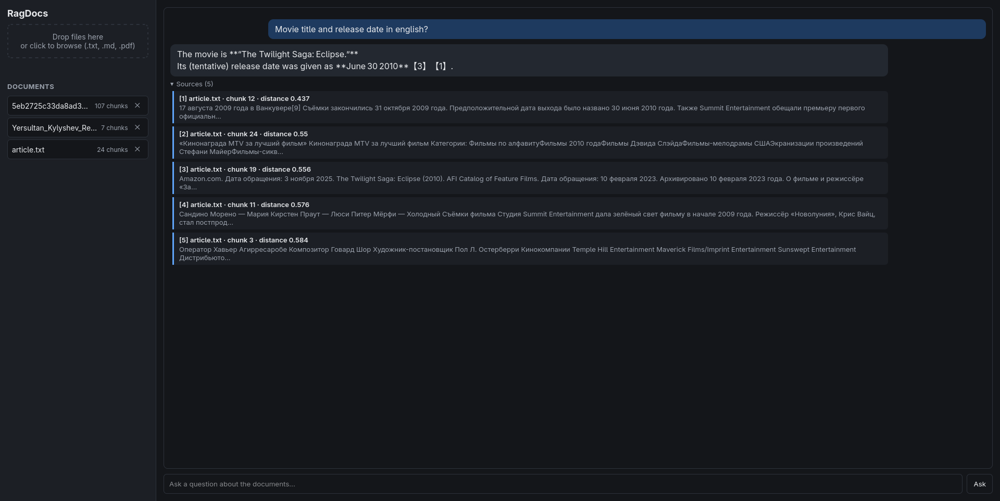
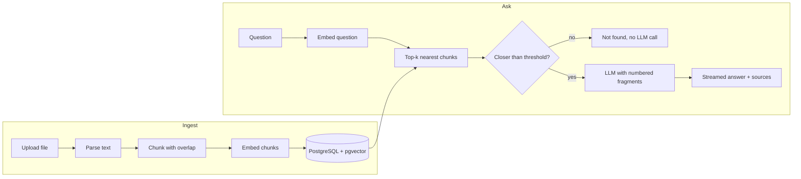

<div align="center">

# RagDocsApi

**Ask questions about your own documents and get answers with cited sources.**
FastAPI · PostgreSQL + pgvector · local embeddings · streaming answers




</div>

---

## Overview

RagDocsApi is a retrieval-augmented generation (RAG) service. You upload `.txt`, `.md` or `.pdf` files; the service splits them into chunks, embeds each chunk locally, and stores the vectors in PostgreSQL. When you ask a question, it finds the most relevant chunks, hands them to an LLM, and streams back an answer that cites its sources as `[1]`, `[2]`, and so on.

Embeddings are computed on your machine (no API key or per-request cost). The answering model is any OpenAI-compatible endpoint, such as Groq's free tier, a local Ollama model, or OpenRouter.

## Features

- **Source-grounded answers.** Every answer is built only from retrieved fragments and cites them by number. A collapsible list under each answer shows the exact text used.
- **Refuses to guess.** If no chunk is close enough to the question, the service answers "not found" without calling the model at all, which saves tokens and avoids made-up answers.
- **Semantic search.** Finds relevant passages by meaning, not keywords, including questions phrased differently from the document.
- **PDF, Markdown and text.** PDF text is cleaned (hyphenated line breaks joined, NUL bytes removed). Password-protected, corrupted and scanned PDFs are rejected with a clear message.
- **Streaming.** Answers arrive token by token over Server-Sent Events, with a Stop button in the UI.
- **Local embeddings.** Multilingual model via [fastembed](https://github.com/qdrant/fastembed) (ONNX, CPU only), baked into the Docker image so the container starts fast and works offline.
- **Fast vector search.** pgvector with an HNSW index using cosine distance.
- **Prompt-injection aware.** Retrieved text is explicitly marked as untrusted data in the system prompt.
- **Measurable quality.** A built-in evaluation script reports hit@k and MRR, and helps pick the distance threshold and chunk size from data instead of guesswork.
- **Reproducible setup.** Alembic migrations, tests that need no network or database, and a single `compose up`.

## How it works



| Module | Responsibility |
|---|---|
| `app/services/parsing.py` | Extracts text from `.txt`, `.md`, `.pdf`; cleans PDF artifacts |
| `app/services/chunking.py` | Splits text on paragraph and sentence boundaries, with overlap |
| `app/services/embeddings.py` | Local embedding model, run in a worker thread to keep the event loop free |
| `app/services/rag.py` | Builds the grounded prompt and the source list |
| `app/services/llm.py` | OpenAI-compatible client with retries, timeouts and friendly errors |
| `app/routers/documents.py` | Upload, list and delete documents |
| `app/routers/search.py` | Raw semantic search (useful for debugging retrieval) |
| `app/routers/ask.py` | Retrieval, threshold filtering and SSE answer streaming |
| `eval/run.py` | Retrieval evaluation and parameter sweeps |

## Quick start

### Docker or Podman

```bash
git clone https://github.com/YOUR_USERNAME/RagDocsApi.git
cd RagDocsApi

cp .env.example .env            # then put your LLM API key into .env
docker compose up -d --build    # or: podman compose up -d --build
```

Open **http://localhost:8000**. Migrations are applied automatically on startup. The first build is slow because it downloads the embedding model.

### Local development

```bash
python3.12 -m venv .venv
source .venv/bin/activate
pip install -r requirements-dev.txt

docker compose up -d db         # just the database (exposed on port 5433)
alembic upgrade head
uvicorn app.main:app --reload
```

## Configuration

Settings come from environment variables or `.env`:

| Variable | Description | Default |
|---|---|---|
| `LLM_BASE_URL` | OpenAI-compatible endpoint | none |
| `LLM_API_KEY` | API key for that endpoint | none |
| `LLM_MODEL` | Model name | none |
| `DATABASE_URL` | Async SQLAlchemy URL | none |
| `EMBEDDING_MODEL` | fastembed model name | `sentence-transformers/paraphrase-multilingual-MiniLM-L12-v2` |
| `EMBEDDING_DIM` | Vector size, must match the model | `384` |
| `CHUNK_SIZE` | Maximum characters per chunk | `500` |
| `CHUNK_OVERLAP` | Characters repeated between neighbouring chunks | `80` |
| `TOP_K` | Chunks retrieved per question | `5` |
| `MAX_DISTANCE` | Cosine distance above which a chunk is ignored | tune with `eval` |
| `MAX_UPLOAD_MB` | Upload size limit | `5` |

Changing the embedding model changes the vector size and makes old vectors incomparable. After switching models, update `EMBEDDING_DIM`, create a new migration, and re-upload your documents.

## API

| Method | Path | Description |
|---|---|---|
| `POST` | `/documents` | Upload a file (multipart, field `file`) |
| `GET` | `/documents` | List documents with chunk counts |
| `DELETE` | `/documents/{id}` | Delete a document and its chunks |
| `GET` | `/search?q=...&k=5` | Nearest chunks with distances, no LLM |
| `POST` | `/ask` | Ask a question; the answer is an SSE stream |
| `GET` | `/health` | Liveness check |

Interactive documentation is available at `/docs`.

### Streaming protocol

`POST /ask` with `{"question": "..."}` returns `text/event-stream`. The first event always carries the sources:

```
data: {"type": "sources", "sources": [{"n": 1, "filename": "paper.pdf", "position": 4, "snippet": "...", "distance": 0.412}]}

data: {"type": "token", "text": "The study found "}

data: {"type": "token", "text": "a 12% increase [1]."}

data: {"type": "usage", "in": 812, "out": 24}

data: {"type": "done"}
```

| Event | Meaning |
|---|---|
| `sources` | Numbered fragments used for the answer (empty if nothing was relevant) |
| `token` | A chunk of generated text |
| `usage` | Token counts (`"estimated": true` if the provider did not report them) |
| `done` | The answer is complete |
| `error` | Generation failed; includes a human-readable `message` |

```bash
curl -F "file=@paper.pdf" http://localhost:8000/documents

curl -N -X POST http://localhost:8000/ask \
  -H "Content-Type: application/json" \
  -d '{"question": "What were the main findings?"}'
```

## Evaluating retrieval quality

The answer can only be as good as the chunks the model receives, so retrieval is measured separately and without a database:

```bash
python3 -m eval.run --doc my_document.txt --show-misses --thresholds
```

It reads `eval/questions.json`, which contains questions with a verbatim phrase from the place in the document where the answer lives, plus off-topic questions. For each configuration it reports:

- **hit@k**: the share of questions whose correct chunk appears in the top k results
- **MRR**: the mean of `1 / rank` of the correct chunk
- **gap**: the distance between the hardest on-topic question and the closest off-topic one. A positive gap means a single `MAX_DISTANCE` threshold can separate them.

Sweep chunk sizes, overlaps or embedding models:

```bash
python3 -m eval.run --doc my_document.txt --chunk-sizes 200,300,500 --overlaps 0,80
python3 -m eval.run --doc my_document.txt --models "model-a,model-b"
```

### Results

<!-- Fill this table from your own runs. Use 15+ questions that you wrote in your own words;
     differences smaller than ~10% are noise on a set this small. -->

| Model | Chunk size | Overlap | hit@1 | hit@3 | hit@5 | MRR | Gap |
|---|---|---|---|---|---|---|---|
| paraphrase-multilingual-MiniLM-L12-v2 | 500 | 80 | | | | | |

Notes on the choices made:

- **Chunk size.** Embedding models read a limited number of tokens, so overly large chunks are silently truncated and produce blurry vectors. Sizes around 300 to 500 characters keep each chunk focused.
- **Overlap.** Repeating the tail of the previous chunk keeps facts that straddle a boundary retrievable.
- **Threshold.** The cut-off is chosen from the on-topic versus off-topic distance gap, not by feel.

## Testing

```bash
python3 -m pytest -v
```

The suite needs no network, no GPU and no database. The LLM, the embedding model and the CRUD layer are replaced by fakes, so tests cover request validation, SSE format, threshold behaviour (including skipping the LLM call), error events, text parsing, chunking and prompt construction.

## Migrations

```bash
alembic revision --autogenerate -m "describe the change"
alembic upgrade head
alembic downgrade -1
```

The initial migration enables the `vector` extension and creates the HNSW index. Generate migrations against an empty or fully migrated database and review the result before applying it.

## Project structure

```
.
├── app/
│   ├── main.py              # app setup, lifespan (model preload), static files
│   ├── config.py            # settings from environment
│   ├── db.py                # async engine and sessions
│   ├── models.py            # Document, Chunk (with vector column and HNSW index)
│   ├── schemas.py           # request/response models
│   ├── crud.py              # database operations, vector search
│   ├── routers/             # documents, search, ask
│   ├── services/            # parsing, chunking, embeddings, rag, llm
│   └── static/index.html    # web UI
├── alembic/                 # migrations
├── eval/                    # retrieval evaluation
├── tests/
├── Dockerfile
├── docker-compose.yml
└── requirements.txt
```

## Limitations

- Scanned PDFs are not supported (no OCR).
- Each question is answered independently; there is no conversation memory yet.
- Token usage for streamed answers can be an estimate when the provider does not report it.
- Quality depends on the embedding model. The default is a general multilingual paraphrase model; models trained for question-to-passage retrieval may do better, which the evaluation script is there to verify.

## Roadmap

- [ ] Conversation memory with question rewriting
- [ ] Hybrid search (keyword plus vector) and reranking
- [ ] OCR for scanned PDFs
- [ ] Per-user document collections with authentication
- [ ] Switch between embedding models without manual re-indexing

## License

MIT. See `LICENSE`.
